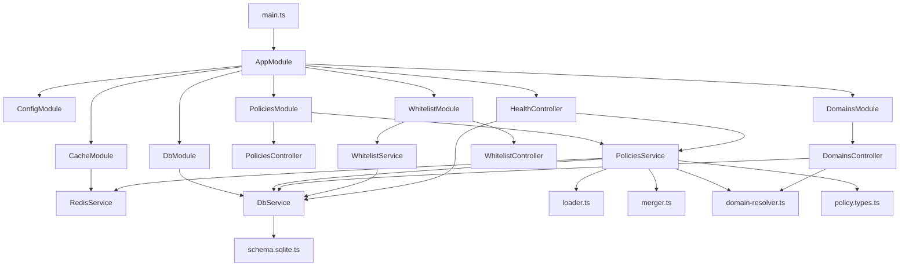
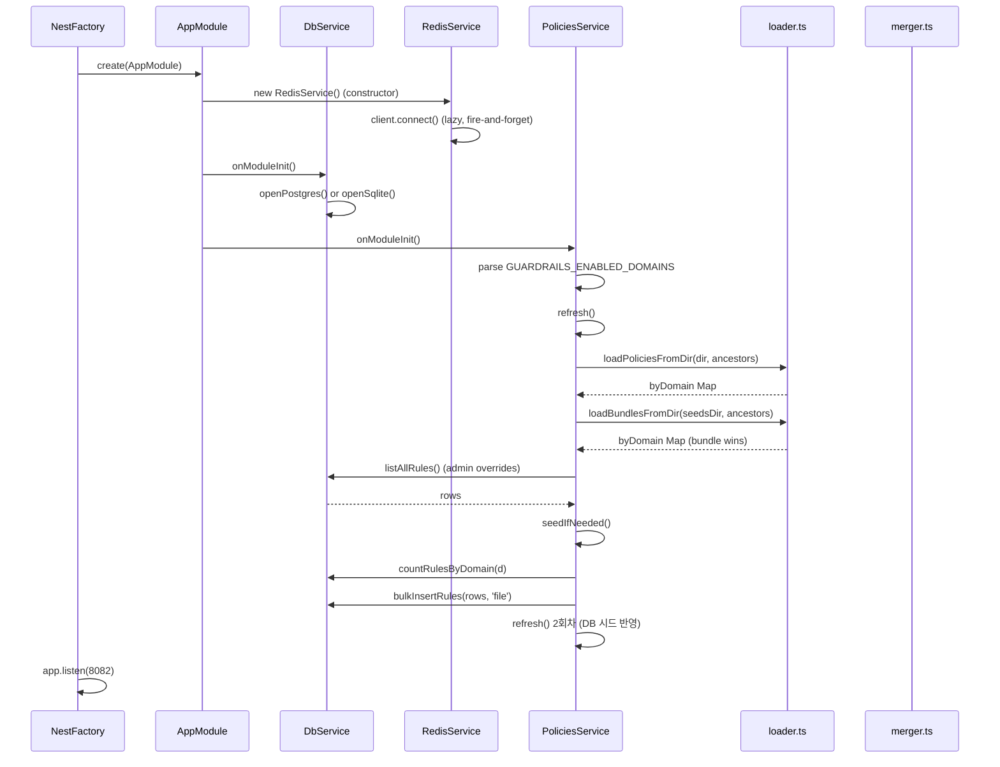
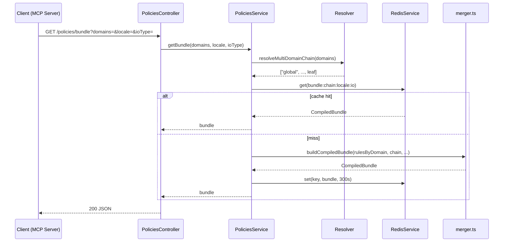
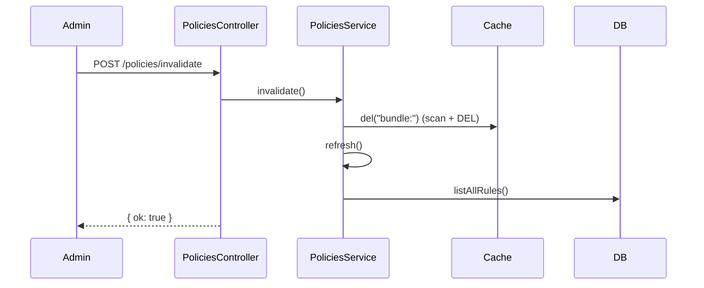

# Guardrails-Service-Policy-Engine — 코드 리뷰 (Level 2)

- 분석일: 2026-05-20
- 대상: `/Users/wise/Developer/Web(Node,Script)/Guardrails-Service-Policy-Engine`
- 리뷰 레벨: **2** (3년차 주니어 핸드오버 품질)
- 선택 파일 수: 20 / 후보 20 (정책 JSON 4개는 데이터로 분류, 부록 A 참조)
- 분석: Claude Opus 4.7 (1M context)

---

## 1. 작업공간 인벤토리 / Workspace Inventory

### 1.1 디렉토리 트리 (depth 4)

```
Guardrails-Service-Policy-Engine/
├── .dockerignore
├── .env.example
├── Dockerfile
├── README.md
├── nest-cli.json
├── package.json
├── tsconfig.json
├── policies/
│   └── global/
│       └── privacy/
│           ├── input.en.json
│           ├── input.ko-KR.json
│           ├── output.en.json
│           └── output.ko-KR.json
└── src/
    ├── app.module.ts
    ├── main.ts
    ├── cache/
    │   ├── cache.module.ts
    │   └── redis.service.ts
    ├── db/
    │   ├── db.module.ts
    │   ├── db.service.ts
    │   └── schema.sqlite.ts
    ├── domains/
    │   ├── domains.controller.ts
    │   └── domains.module.ts
    ├── health/
    │   └── health.controller.ts
    ├── policies/
    │   ├── __tests__/
    │   │   ├── domain-resolver.spec.ts
    │   │   └── merger.spec.ts
    │   ├── domain-resolver.ts
    │   ├── loader.ts
    │   ├── merger.ts
    │   ├── policies.controller.ts
    │   ├── policies.module.ts
    │   ├── policies.service.ts
    │   └── policy.types.ts
    └── whitelist/
        ├── whitelist.controller.ts
        ├── whitelist.module.ts
        └── whitelist.service.ts
```

### 1.2 파일 카운트

| 영역 | 파일 수 | 총 LOC |
|---|---:|---:|
| `src/` (TS 소스) | 18 | 1,015 |
| `src/policies/__tests__` (spec) | 2 | 83 |
| `policies/` (정책 JSON, 데이터) | 4 | 402 |
| 빌드/매니페스트 | 6 | — |

- 언어 분포: TypeScript 100% (`.ts` 20개), JSON 정책 시드 4개.

### 1.3 빌드/의존 매니페스트 / Manifests

| 파일 | 역할 | 주요 버전 |
|---|---|---|
| `package.json` | NestJS 10 단일 서비스 | `@nestjs/*@^10.3.0`, `typescript@^5.4.0`, `zod@^3.22.4`, `pg@^8.11.5`, `better-sqlite3@^11`, `ioredis@^5.3.2`, `ajv@^8.12.0` (선언만, 미사용) |
| `tsconfig.json` | `strict:true`, `target:ES2022`, `module:commonjs`, `outDir:./dist` |
| `nest-cli.json` | `policies/**/*` 를 `dist`로 복사 (assets) |
| `Dockerfile` | 멀티스테이지 `node:20-alpine`, 8082 포트, `dist/main.js` 실행 |
| `.env.example` | 8082 / Postgres / Redis 기본값 |

### 1.4 락파일

- 락파일 부재 (`package-lock.json` / `yarn.lock` / `pnpm-lock.yaml` 모두 없음). 재현 빌드 약함 — `.review/CODE-REVIEW-Lv2/` §4 위험 항목 참조.

### 1.5 진입점 후보

1. `src/main.ts` — `NestFactory.create(AppModule)` → `app.listen(PORT)` (단일 진입점)
2. 부차 진입점: NestJS 라이프사이클 훅 `onModuleInit` 으로 묶인 `DbService` / `PoliciesService` / `RedisService`

### 1.6 테스트 디렉토리

- `src/policies/__tests__/*.spec.ts` (Jest, ts-jest, rootDir=src). E2E 설정(`jest-e2e.json`)은 스크립트만 존재, 파일은 부재 — **확인 불가**.

---

## 2. 프로젝트 구조 / Project Structure

### 2.1 소스 트리 (역할 한 줄)

```
src/
├── main.ts                   # NestJS 부트스트랩, 8082 포트 listen, shutdown hook
├── app.module.ts             # 루트 모듈: Config + Cache + Db + Policies + Domains + Whitelist
├── cache/
│   ├── cache.module.ts       # @Global, RedisService provider 노출
│   └── redis.service.ts      # ioredis lazyConnect, fail-open get/set/del scan
├── db/
│   ├── db.module.ts          # @Global, DbService provider 노출
│   ├── db.service.ts         # Postgres ↔ SQLite 듀얼 드라이버 파사드
│   └── schema.sqlite.ts      # SQLite DDL 문자열 (domains/whitelists/rules/policy_versions)
├── domains/
│   ├── domains.controller.ts # GET /domains, /:key/chain, /:keys/chain-multi
│   └── domains.module.ts
├── health/
│   └── health.controller.ts  # GET /health → status + 룰 카운트 + DB 가용성
├── policies/
│   ├── policies.module.ts    # Controller + Service
│   ├── policies.controller.ts# GET /policies/bundle, POST /invalidate, /domains, /:domain/count
│   ├── policies.service.ts   # 부트 시 file+bundle+DB 머지, 캐시 키 빌더, invalidate
│   ├── loader.ts             # loadPoliciesFromDir (dir-walk) + loadBundlesFromDir (flat)
│   ├── merger.ts             # ACTION_STRICTNESS 기반 충돌 해소 + buildCompiledBundle
│   ├── domain-resolver.ts    # leaf → 조상 체인, 멀티 leaf 유니온
│   ├── policy.types.ts       # zod RuleSchema, CompiledBundle 인터페이스
│   └── __tests__/            # merger / domain-resolver 단위테스트
└── whitelist/
    ├── whitelist.controller.ts # GET /whitelist?domain=&locale=
    ├── whitelist.module.ts
    └── whitelist.service.ts    # DB row → API DTO 매핑
```

### 2.2 모듈 의존 그래프



내부 의존: `DbService`는 4개 모듈 (Policies / Domains / Whitelist / Health) 에서 사용 (in-degree 최고). `RedisService`는 `PoliciesService` 만 직접 사용.

### 2.3 호출/응답 흐름 (주요 진입점)

#### Bootstrap → seed



#### GET /policies/bundle (런타임)



#### POST /policies/invalidate



### 2.4 외부 패키지 인벤토리

| 패키지 | 버전 | 사용처 | 역할 | 라이선스 |
|---|---|---|---|---|
| `@nestjs/common` | ^10.3.0 | 전 모듈 (`@Injectable`, `@Controller`, `@Module`, `Logger`) | DI / HTTP 데코레이터 | MIT |
| `@nestjs/core` | ^10.3.0 | `main.ts` (`NestFactory`) | 부트스트랩 | MIT |
| `@nestjs/config` | ^3.2.0 | `app.module.ts` (`ConfigModule.forRoot`) | env 글로벌 노출 (단, 실제로는 `process.env` 직접 사용) | MIT |
| `@nestjs/platform-express` | ^10.3.0 | (런타임) | HTTP 어댑터 | MIT |
| `pg` | ^8.11.5 | `db.service.ts` | Postgres `Pool` | MIT |
| `better-sqlite3` | ^11.0.0 | `db.service.ts` (동적 import) | 단일파일 DB | MIT |
| `ioredis` | ^5.3.2 | `redis.service.ts` | Redis 클라이언트 (lazyConnect, scanStream) | MIT |
| `zod` | ^3.22.4 | `policy.types.ts` (`RuleSchema`), `loader.ts`, `policies.service.ts` | 런타임 룰 검증 | MIT |
| `reflect-metadata` | ^0.2.0 | (NestJS DI) | 데코레이터 메타데이터 | Apache-2.0 |
| `rxjs` | ^7.8.1 | (NestJS 내부) | 미사용 (transitively used) | Apache-2.0 |
| `ajv` | ^8.12.0 | **선언만, 미사용** | (제거 후보) | MIT |

devDependencies: `jest`, `ts-jest`, `supertest` (e2e 미구현), `@types/*`, `@nestjs/cli`, `@nestjs/testing`, `ts-node`, `typescript`.

### 2.5 데이터 흐름 / 상태 저장소

- **영구 저장소**: Postgres(`POSTGRES_*` env) 또는 SQLite(`SQLITE_PATH` env, 기본 `./var/policy-engine.db`). 테이블: `domains`, `rules`, `whitelists`, `policy_versions`. DDL은 SQLite만 코드에 인라인 — Postgres DDL은 외부(다른 레포 `init-db.sql`).
- **휘발성 캐시**: Redis (`REDIS_HOST/PORT`, TTL=300s). 키 패턴 `bundle:<chain>:<locale>:<ioType>`.
- **인메모리 상태**: `PoliciesService.rulesByDomain: Map<string, Rule[]>` — 부트 시점 1회 빌드 + `invalidate()` 호출 시 갱신.
- **설정 소스**: `process.env.*` 직접 참조 (NestJS `ConfigService` 사용 안 함).
- **I/O 경계**:
  - 인바운드: HTTP 8082 (Nest Express)
  - 아웃바운드: Postgres TCP / Redis TCP / 파일시스템 (`POLICY_DIR`, `SEEDS_DIR`)
  - 파일 시드 경로: `POLICY_DIR` 기본 `<dist>/../policies`, `SEEDS_DIR` 기본 `../../../../MCP-type-Guardrails-Service/scripts` (모노레포 상대경로)

### 2.6 진입점 목록 (번호)

1. `bootstrap()` in [`src/main.ts:5`](./src/main.ts.md)
2. `PoliciesService.onModuleInit()` in [`src/policies/policies.service.ts:19`](./src/policies/policies.service.ts.md)
3. `DbService.onModuleInit()` in [`src/db/db.service.ts:49`](./src/db/db.service.ts.md)
4. HTTP 라우트 (총 9개):
   - `GET /health`
   - `GET /policies/bundle`
   - `POST /policies/invalidate`
   - `GET /policies/domains`
   - `GET /policies/:domain/count`
   - `GET /domains`
   - `GET /domains/:key/chain`
   - `GET /domains/:keys/chain-multi`
   - `GET /whitelist`

---

## 3. 리뷰 파일 선정 / Selected Files

### 선정 기준 (Level 2)

진입점 → 2 hop 이내 도달 → in-degree 상위 → 진입점 근방 테스트 → 잔여. 캡 `--max-files 40`. 총 20개 (전체 TS 소스).

### 선정된 파일

| # | 경로 | 역할 | LOC | 링크 |
|---:|---|---|---:|---|
| 1 | `src/main.ts` | NestJS 부트스트랩 | 12 | [리뷰](./src/main.ts.md) |
| 2 | `src/app.module.ts` | 루트 모듈 | 21 | [리뷰](./src/app.module.ts.md) |
| 3 | `src/cache/cache.module.ts` | Cache 모듈 | 9 | [리뷰](./src/cache/cache.module.ts.md) |
| 4 | `src/cache/redis.service.ts` | Redis 파사드 (fail-open) | 55 | [리뷰](./src/cache/redis.service.ts.md) |
| 5 | `src/db/db.module.ts` | DB 모듈 | 9 | [리뷰](./src/db/db.module.ts.md) |
| 6 | `src/db/db.service.ts` | Postgres/SQLite 듀얼 드라이버 | 306 | [리뷰](./src/db/db.service.ts.md) |
| 7 | `src/db/schema.sqlite.ts` | SQLite DDL 문자열 | 81 | [리뷰](./src/db/schema.sqlite.ts.md) |
| 8 | `src/domains/domains.controller.ts` | 도메인 조회 컨트롤러 | 27 | [리뷰](./src/domains/domains.controller.ts.md) |
| 9 | `src/domains/domains.module.ts` | 도메인 모듈 | 5 | [리뷰](./src/domains/domains.module.ts.md) |
| 10 | `src/health/health.controller.ts` | /health 엔드포인트 | 18 | [리뷰](./src/health/health.controller.ts.md) |
| 11 | `src/policies/domain-resolver.ts` | 도메인 체인 해석 | 40 | [리뷰](./src/policies/domain-resolver.ts.md) |
| 12 | `src/policies/loader.ts` | 파일/번들 룰 로더 | 130 | [리뷰](./src/policies/loader.ts.md) |
| 13 | `src/policies/merger.ts` | 액션 엄격도 기반 머저 | 82 | [리뷰](./src/policies/merger.ts.md) |
| 14 | `src/policies/policies.controller.ts` | 룰 번들 API | 39 | [리뷰](./src/policies/policies.controller.ts.md) |
| 15 | `src/policies/policies.module.ts` | 폴리시 모듈 | 10 | [리뷰](./src/policies/policies.module.ts.md) |
| 16 | `src/policies/policies.service.ts` | 룰 통합 서비스 (핵심) | 183 | [리뷰](./src/policies/policies.service.ts.md) |
| 17 | `src/policies/policy.types.ts` | zod 스키마 + 타입 | 59 | [리뷰](./src/policies/policy.types.ts.md) |
| 18 | `src/whitelist/whitelist.controller.ts` | 화이트리스트 컨트롤러 | 12 | [리뷰](./src/whitelist/whitelist.controller.ts.md) |
| 19 | `src/whitelist/whitelist.module.ts` | 화이트리스트 모듈 | 6 | [리뷰](./src/whitelist/whitelist.module.ts.md) |
| 20 | `src/whitelist/whitelist.service.ts` | 화이트리스트 서비스 | 28 | [리뷰](./src/whitelist/whitelist.service.ts.md) |

테스트:
| # | 경로 | 역할 | LOC | 링크 |
|---:|---|---|---:|---|
| T1 | `src/policies/__tests__/domain-resolver.spec.ts` | 체인 해석 단위테스트 | 29 | [리뷰](./src/policies/__tests__/domain-resolver.spec.ts.md) |
| T2 | `src/policies/__tests__/merger.spec.ts` | 머저 단위테스트 | 54 | [리뷰](./src/policies/__tests__/merger.spec.ts.md) |

### 보류된 파일 / Deferred

| 경로 | 보류 사유 |
|---|---|
| `policies/global/privacy/*.json` (4개) | 데이터(시드 룰). 정적 분석 대상 아님. 부록 A 참조. |
| `README.md` | 문서. 본 리뷰 정책상 제외. |
| `Dockerfile` / `nest-cli.json` / `tsconfig.json` / `.env.example` / `package.json` / `.dockerignore` | 매니페스트. §1.3에서 요약. |

---

## 4. 종합 분석 / Whole-Codebase Synthesis

### 4.1 반복 패턴 / Idioms & Anti-patterns

**A. fail-open 패턴** — `RedisService` ([redis.service.ts:25, 34, 40, 45](./src/cache/redis.service.ts.md)), `DbService` ([db.service.ts:69, 87](./src/db/db.service.ts.md)) 둘 다 외부 의존성 실패 시 `warn` 로깅 후 정상 흐름을 진행. 룰 로딩 실패 시 `loader.ts`도 빈 결과 반환. **장점**: 부트 안정. **위험**: 잘못된 상태(룰 0개, DB unavailable)를 200 OK로 응답할 가능성 — `/health`는 `status:'ok'` 고정.

**B. `process.env.*` 직접 참조** — `main.ts:8`, `redis.service.ts:11-12`, `db.service.ts:45-46, 75-80`, `policies.service.ts:20, 82-83`. `ConfigModule.forRoot({isGlobal:true})` 가 import 되어 있으나 `ConfigService` 미사용. 단일 출처가 부재.

**C. zod 안전 파싱 + warn 후 스킵** — `loader.ts:73, 113`, `policies.service.ts:129`. 잘못된 룰 1건이 부트 전체를 죽이지 않음. 다만 `parsed.error.message`만 로깅하므로 어떤 룰이 잘못됐는지 추적 어려움 (zod issue 경로 미포함).

**D. JSON 컬럼 양방향 직렬화 (SQLite)** — `db.service.ts` 전반. Postgres는 네이티브 배열/JSONB를, SQLite는 JSON 문자열을 사용. 매핑이 메서드마다 인라인 반복 — DRY 위반 (3개 메서드 × 5개 컬럼 = 15회 동일 패턴).

**E. 컨트롤러가 서비스 메서드를 단순 위임** — `domains.controller.ts:11-15`, `policies.controller.ts:9-22`, `whitelist.controller.ts:8-11`. DTO 검증(`class-validator`)이 없음. 쿼리 파라미터를 그대로 신뢰.

### 4.2 계층 위반 / Layering Violations

1. **컨트롤러가 도메인 로직 import** — `domains.controller.ts:3` 가 `policies/domain-resolver` 를 직접 import. 작은 함수라 큰 결합은 아니지만 모듈 경계는 흐려짐.
2. **`policies.service.ts:83` 모노레포 상대경로** — `path.resolve(__dirname, '../../../../MCP-type-Guardrails-Service/scripts')`. 빌드 결과(`dist/`)의 4단계 위 디렉토리를 가정. 컨테이너 빌드에서는 존재하지 않음 → 항상 빈 번들 로드(silently). 서비스 코드가 워크스페이스 레이아웃에 결합.
3. **DDL 분기** — Postgres 스키마는 외부 레포에 (`init-db.sql`), SQLite 스키마는 코드 안(`schema.sqlite.ts`)에 존재. 두 스키마의 표현(JSONB vs TEXT, TIMESTAMPTZ vs TEXT, 체크 제약 등)이 분리되어 있어 변경 동기화가 수작업.

### 4.3 위험 핫스팟 Top-5

| # | 위치 | 한 줄 사유 |
|---:|---|---|
| 1 | `policies.service.ts:83` — `SEEDS_DIR` 기본값 | 모노레포 상대경로 의존; Docker/외부배치에서 항상 빈 번들 → 정책 갱신 누락 사일런트 실패 |
| 2 | `db.service.ts:180-200` — Postgres `bulkInsertRules` | 단일 트랜잭션 아님(루프 내 N회 query); 대량 시드 시 부분 성공 가능 |
| 3 | `redis.service.ts:21-26` — 생성자 `connect()` fire-and-forget | DI 컨테이너가 RedisService를 준비됐다고 간주하지만 connect는 비동기로 계속 진행, 첫 요청이 false-negative 캐시-less로 떨어질 가능성 |
| 4 | `policies.service.ts:24-28` — 부트 시 `refresh()` 2회 호출 | 두 번째 호출이 첫 번째 머지 결과 + DB를 다시 머지 → 시간복잡도 O(N) × 2; 또한 DB가 비어 있어 `seedIfNeeded`가 모두 시드한 경우만 의미 있음 |
| 5 | `merger.ts:46-50` — 머지 결정 로직 | `stricter()` 결과와 `idx >= existing.orderIdx` 가 OR 결합되어 있어, 더 엄격하지 않은 후순위 도메인 룰이 키를 덮어쓸 수 있는 경계 케이스가 존재 (테스트 미커버) |

### 4.4 삭제 후보 / Dead-code Candidates

- `package.json:21` `"ajv": "^8.12.0"` — 런타임 import 없음. 제거 가능.
- `app.module.ts:12` `ConfigModule.forRoot({isGlobal:true})` — `ConfigService` 미사용. 명시적 설정 계층이 필요하지 않다면 제거하거나, 사용하지 않는 이유 주석.
- `policies.controller.ts:35-38` `count(:domain)` — 파라미터 `_d`를 사용하되 `ruleCount()`는 도메인 무관 전체 카운트 반환. 의도 불일치(버그성).
- `rxjs` 직접 import 없음 — NestJS transitive 라 제거 불가, 그대로 두기.

### 4.5 테스트 공백 / Test Gaps

- 커버됨: `domain-resolver.ts` (3 케이스), `merger.ts` (3 케이스).
- 미커버:
  - `loader.ts` — 디렉토리 워크, 번들 검증, 도메인 미스매치, 손상 JSON 처리.
  - `policies.service.ts` — `refresh()` 의 file/bundle/DB 3-way 머지 우선순위, `seedIfNeeded()` 멱등성, `getBundle()` 캐시 hit/miss.
  - `db.service.ts` — 듀얼 드라이버 동일성, 트랜잭션 경계, 빈 입력 처리.
  - `redis.service.ts` — fail-open 모드, `del(prefix)` scan + delete.
  - HTTP e2e — `jest-e2e.json` 미구현.

### 4.6 다음 단계 (우선순위 순) / Next Steps

1. **`SEEDS_DIR` 기본값 제거 또는 명시화** — 컨테이너 외부 경로 의존성을 끊고 env 미설정 시 경고 로그.
2. **`bulkInsertRules` Postgres 트랜잭션화** — `client = await pg.connect(); BEGIN; … COMMIT;`.
3. **`PoliciesService.refresh()` 2회 호출 제거** — `seedIfNeeded()` 가 성공한 경우만 1회 추가 호출하도록 조건화.
4. **`RedisService` 준비 상태 await 또는 헬스체크 반영** — `/health` 에 `redis.connected` 노출 + `getBundle()` 캐시 시도 전 1회 동기 대기.
5. **`ConfigService` 도입** — env 단일 출처화 + 타입 검증.
6. **loader 에러 메시지 강화** — `parsed.error.issues` 의 `path` 와 `message`를 모두 로깅.
7. **`policies.controller.ts:count()` 의 도메인 무시 버그 수정**.
8. **e2e 테스트 활성화** — `jest-e2e.json` 추가, `/policies/bundle` + `/health` 골든 경로 커버.
9. **락파일 커밋** — 의존성 재현 빌드.
10. **Postgres DDL 을 본 레포로 가져오거나 `schema.sqlite.ts` 와 함께 단일 출처화**.

---

## 5. 부록 / Appendix

### A. 보류된 파일 — 정책 시드 JSON

`policies/global/privacy/*.json` 4개 (input/output × en/ko-KR). 각 파일은 `{ "$schema": ..., "domain": "global", "locale": "...", "rules": [...] }` 구조. 코드 리뷰 대상이 아니나, `loader.ts:64-66` 의 `enabled.has(bundleDomain)` 가 `bundle.domain==="global"`을 통과시키므로 부트 시 모두 로드됨. 룰 1건당 `ruleId/domain/locale/ioType/category/severity/priority/action/messageTemplate/regulationTags/examples*/enabled/version` 필드를 가진다.

### B. 전체 패키지 인벤토리

§2.4 참조 (목록이 짧아 본문에서 종결).

### C. 용어집

Level 2 옵션 — 생략.

---

*분석 종료. 각 파일 리뷰는 `./src/<path>.md` 와 디렉토리 단위 `<dirname>_Abstract.md` 를 참조.*
